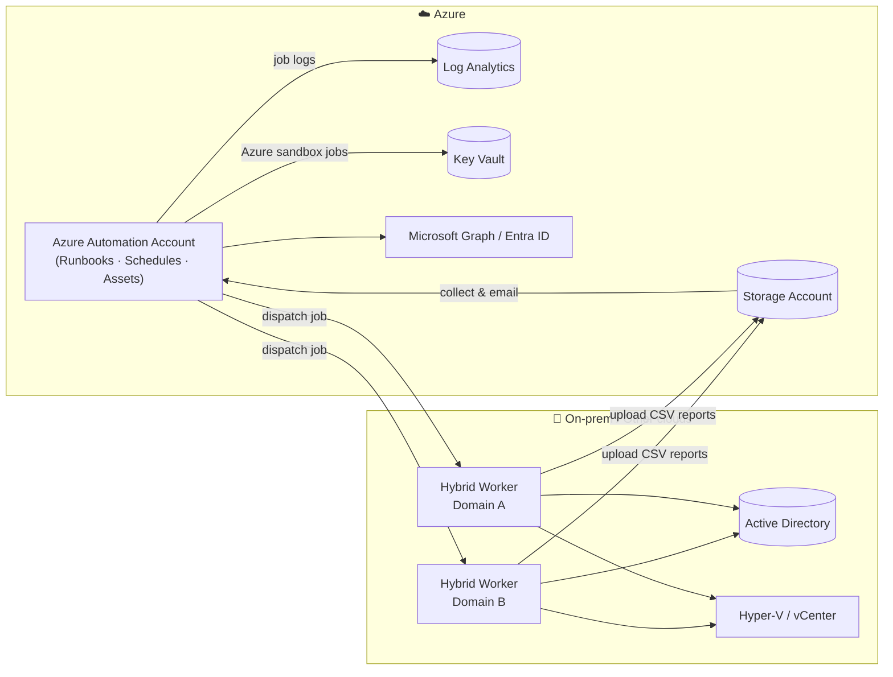

<div align="center">

# ⚙️ Azure Automation Runbooks & Hybrid Workers

**Ready-to-use PowerShell runbooks for automating Azure, Entra ID, and on-prem Active Directory from a single Azure Automation Account.**

[](https://github.com/21bshwjt/AzAutomationRunbooks/actions/workflows/lint.yml)


[](https://github.com/21bshwjt/AzAutomationRunbooks/stargazers)
[](https://github.com/21bshwjt/AzAutomationRunbooks/commits/main)

[Runbook catalog](#-runbook-catalog) •
[Quick start](#-quick-start) •
[Architecture](#-architecture) •
[Authentication](#-authentication-setup) •
[Contributing](#-contributing)

</div>

---

## 💡 Why this repo?

Most organizations run **hybrid**: some workloads in Azure, some in on-prem data centers. Azure Automation lets you write a script once, schedule it centrally, and run it either in Azure's sandbox or on **Hybrid Runbook Workers** (Windows & Linux VMs, in Azure or on-prem).

This repo collects runbooks that solve everyday ops problems — VM power management, Key Vault hygiene, AD account checks, Secure Score reporting — so you can import them and be productive in minutes.

- ✅ **Automate routine tasks** across Azure and on-prem
- ✅ **Schedule jobs centrally** and run them on many environments/domains
- ✅ **Azure SSO** via Service Principal certificate or Managed Identity — no passwords in scripts
- ✅ **Source-controlled** runbooks you can sync straight into Automation
- ✅ Supports **PowerShell** & **Python** runbooks

📚 Microsoft docs: [Start a runbook](https://learn.microsoft.com/en-us/azure/automation/start-runbooks) · [Hybrid Runbook Worker overview](https://learn.microsoft.com/en-us/azure/automation/automation-hybrid-runbook-worker)

---

## 📦 Runbook catalog

| Runbook | What it does | Runs on | Auth / Requirements |
|---|---|---|---|
| [PoweredOn_Bulk_VMs.ps1](PoweredOn_Bulk_VMs.ps1) | Starts every VM across a list of resource groups (as background jobs) | ☁️ Azure | SPI connection · `Az.Compute` |
| [PoweredOff_Bulk_VMs.ps1](PoweredOff_Bulk_VMs.ps1) | Stops every VM across a list of resource groups | ☁️ Azure | SPI connection · `Az.Compute` |
| [Get-VMs.ps1](Get-VMs.ps1) | Lists VMs in a resource group — great as an auth smoke test | ☁️ Azure | SPI connection · `Az.Compute` |
| [GetFailedJobs.ps1](GetFailedJobs.ps1) | Queries Log Analytics (KQL) for runbook jobs that failed in the last 4 hours | ☁️ Azure | SPI connection · `Az.OperationalInsights` · diagnostics sent to a workspace |
| [AutoDisable-OlderVersions-Secrets.ps1](AutoDisable-OlderVersions-Secrets.ps1) | Disables all but the latest version of every secret in a Key Vault | ☁️ Azure | SPI connection · `Az.KeyVault` · Key Vault write access |
| [KVSecretExpiryEmailNotifications.ps1](KVSecretExpiryEmailNotifications.ps1) | Emails an HTML report of Key Vault secrets that are expired or expire within 15 days | 🖥️ Hybrid Worker | Certificate in `LocalMachine\My` · SMTP relay |
| [SecureScore_EmailNotification.ps1](SecureScore_EmailNotification.ps1) | Emails an HTML report of Microsoft Secure Score history (last 90 days) via Graph | ☁️ Azure | App registration with `SecurityEvents.Read.All` + `Mail.Send` |
| [SecureScore_EmailNotification_WIth_commnets.ps1](SecureScore_EmailNotification_WIth_commnets.ps1) | Same as above, fully commented — **start here if you're learning** | ☁️ Azure | Same as above |
| [GrappAPI.ps1](GrappAPI.ps1) | Lists Entra ID users through Microsoft Graph | ☁️ Azure | SPI connection · `Microsoft.Graph.Authentication` · `User.Read.All` |
| [Get-ADUser.ps1](Get-ADUser.ps1) | Looks up an AD user by `sAMAccountName` | 🖥️ Hybrid Worker | `ActiveDirectory` module (RSAT) |
| [GetADPwdExpiryDate.ps1](GetADPwdExpiryDate.ps1) | Reports an AD account's state: exists, enabled, locked out, password expired / never expires / expiry date | 🖥️ Hybrid Worker | `ActiveDirectory` module (RSAT) |
| [Resolve-DNS.ps1](Resolve-DNS.ps1) | Resolves a VM's FQDN in the worker's AD DNS domain | 🖥️ Hybrid Worker | Domain-joined worker |

> **Placeholders:** every script uses values like `<SPI>`, `<Subscription_ID>`, `<RG_Name>` or `<KeyVault>`. Search for `<` and replace them before publishing the runbook.

---

## 🚀 Quick start

1. **Create an Automation Account** in the Azure portal (you need *Contributor* on the subscription/RG).
2. **Set up authentication** — see [Authentication setup](#-authentication-setup) below.
3. **Import the modules** the runbook needs (*Automation Account → Modules → Browse gallery*), e.g. `Az.Accounts`, `Az.Compute`, `Az.KeyVault`.
4. **Import a runbook:**
   ```powershell
   Import-AzAutomationRunbook -Path .\Get-VMs.ps1 -Type PowerShell `
       -ResourceGroupName "<RG>" -AutomationAccountName "<AutomationAccount>" -Published
   ```
   …or use *Runbooks → Import a runbook* in the portal, or link this repo via *Source control*.
5. **Replace the placeholders**, hit **Test pane**, then **Publish** and attach a **Schedule**.
6. For on-prem runbooks, choose **Run on → Hybrid Worker** and select your worker group.

---

## 🏗️ Architecture



### Example end-to-end flow

1. One runbook runs on Hybrid Workers in **multiple on-prem domains** and exports powered-off VMs (Hyper-V / vCenter) to CSV.
2. Each worker uploads its CSV to an **Azure Storage** container.
3. A second runbook downloads all CSVs and sends them to the responsible teams in **a single email**.

One piece of code, one schedule, *n* domains.

<details>
<summary><b>Sample: upload a CSV to Azure Storage from a runbook</b></summary>

```powershell
# Get the Azure Automation connection object
$connection = Get-AutomationConnection -Name "<AZ_SPI_Connection_Name>"

# Connect to Azure using the connection object
Try {
    Connect-AzAccount -ServicePrincipal `
        -Tenant $connection.TenantID `
        -ApplicationId $connection.ApplicationID `
        -CertificateThumbprint $connection.CertificateThumbprint | Out-Null
}
catch {
    Write-Error -Message $_.Exception
    throw $_.Exception
}
Set-AzContext -SubscriptionId "<SUBID>" | Out-Null

$storageAccountRG     = "<storageAccountRG>"
$storageAccountName   = "<storageAccountName>"
$storageContainerName = "<storageContainerName>"
$localPath            = "<Local_Path>"

# Get Storage Account Key and context
$storageAccountKey  = (Get-AzStorageAccountKey -ResourceGroupName $storageAccountRG -AccountName $storageAccountName).Value[0]
$destinationContext = New-AzStorageContext -StorageAccountName $storageAccountName -StorageAccountKey $storageAccountKey

# Generate a 1-hour SAS URI and upload with AzCopy
$containerSASURI = New-AzStorageContainerSASToken -Context $destinationContext -ExpiryTime (Get-Date).AddSeconds(3600) -FullUri -Name $storageContainerName -Permission rw
Write-Output "Uploading $localPath into $storageContainerName container"
azcopy copy $localPath $containerSASURI
```
</details>

---

## 🔐 Authentication setup

The runbooks authenticate with a **Service Principal + certificate**, stored as an Automation *connection*. A **User-/System-assigned Managed Identity** works too — swap the login block for `Connect-AzAccount -Identity`.

1. Create an Automation Account.
2. Create a Service Principal (App registration).
3. Grant it the role it needs (e.g. *Contributor*) on the subscription or resource group.
4. Bind a certificate to the Service Principal.
5. Upload the certificate (`.pfx`) to the Automation Account (*Certificates*).
6. Create a Service Principal **connection** under the Automation Account (*Connections*).
7. Create a PowerShell runbook and test the login:

```powershell
$connection = Get-AutomationConnection -Name "<AzureConnection_Name>"

Try {
    Connect-AzAccount -ServicePrincipal `
        -Tenant $connection.TenantID `
        -ApplicationId $connection.ApplicationID `
        -CertificateThumbprint $connection.CertificateThumbprint | Out-Null
}
catch {
    Write-Error -Message $_.Exception
    throw $_.Exception
}

Set-AzContext -SubscriptionId "<SubID>"
Get-AzVM -ResourceGroupName "<RG_Name>" | Select-Object Name
```

<details>
<summary><b>Testing the same login from a Windows Hybrid Worker</b></summary>

Import the same certificate (`.pfx`) into the worker's `LocalMachine\My` store, then:

```powershell
$ThumbPrint = (Get-ChildItem "Cert:\LocalMachine\My" | Where-Object { $_.Subject -eq "CN=<Certificate Subject>" }).Thumbprint
$AppID      = "<Application_ID>"
$TenantId   = "<Tenant_ID>"

Connect-AzAccount -CertificateThumbprint $ThumbPrint -ApplicationId $AppID -Tenant $TenantId -ServicePrincipal
Set-AzContext -SubscriptionId "<SubID>"
```
</details>

<details>
<summary><b>Graph-based runbooks (Secure Score)</b></summary>

The Secure Score runbooks use the client-credentials flow with assets stored in the Automation Account:

| Asset type | Name | Value |
|---|---|---|
| Variable | `GraphTenantId` | Your tenant ID |
| Credential | `GraphAppCred` | Username = app (client) ID, Password = client secret |

Grant the app **application** permissions `SecurityEvents.Read.All` and `Mail.Send`, then admin-consent. See [Manage credentials in Azure Automation](https://learn.microsoft.com/en-us/azure/automation/shared-resources/credentials?tabs=azure-powershell).

> 💡 Consider scoping `Mail.Send` to the sender mailbox with an [Exchange application access policy](https://learn.microsoft.com/en-us/graph/auth-limit-mailbox-access).
</details>

---

## 🌟 Benefits of Hybrid Runbook Workers

| | |
|---|---|
| 🌐 **Extended reach** | Automate resources Azure can't reach directly — AD, Hyper-V, vCenter, file servers |
| 🎛️ **Unified management** | One place to manage schedules, logs, and credentials for cloud and on-prem |
| 🔒 **Security & compliance** | Certificates and managed identities instead of stored passwords; full job history |
| 📈 **Scalable** | Worker groups spread load; add domains without changing code |
| 🔁 **Run once, everywhere** | **Schedule a single runbook against *n* on-prem domains** |

---

## 🤝 Contributing

Contributions are welcome — new runbooks, fixes, and docs improvements alike. Read [CONTRIBUTING.md](CONTRIBUTING.md) to get started, and please ⭐ the repo if it saved you time!

## ⚠️ Disclaimer

These scripts are provided as-is. Always test in a non-production subscription first — some runbooks (e.g. bulk VM power-off, disabling secret versions) make changes at scale.
